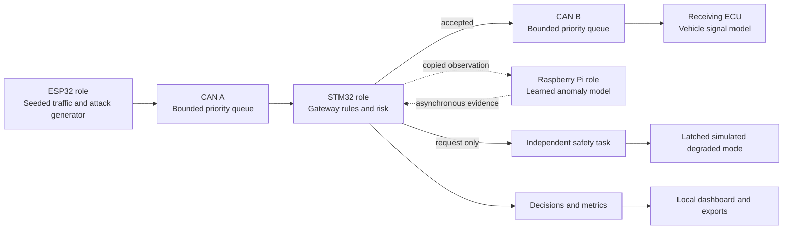

# Architecture and assumptions

Sentinel ECU preserves the roles described in the supplied project references while replacing hardware with isolated software components. The simulation is intended to demonstrate a security decision and its consequences with traceable evidence.

## Time and determinism

The engine advances in fixed simulated-time steps. A pseudorandom generator seeded by the session configuration controls synthetic traffic and attacks. Repeating a seed and the same commands at the same simulated times reproduces logical decisions. Host-clock processing measurements and report creation dates are deliberately excluded from reproducibility comparisons.

The web server advances 50 milliseconds multiplied by the selected speed every 50 milliseconds of requested host timer time. This is not a real-time scheduler. A slow host may take longer to complete a run while preserving simulated-time behavior. Pause stops simulated time; step advances it explicitly.

Each classical CAN frame consumes a modeled bit budget on its bus. Lower numerical IDs win modeled priority selection when multiple frames are queued. The engine approximates serialization and queuing; it does not implement bit-level arbitration, exact bit stuffing, CRC polynomial verification, ACK slots, error confinement, retransmission, propagation delays, or transceiver electronics. Queue overflow is visible in drop counters and evidence.

## Trust boundaries

1. All frames are untrusted inputs to the gateway. Origin names and evaluator labels do not decide forwarding.
2. Gateway rules run without the analyst. A disconnected Pi removes learned observations, not basic forwarding/filtering.
3. Statistical analysis observes copied traffic and returns delayed evidence. Learning is performed on separate synthetic normal samples; live attack labels never train the detector.
4. The response coordinator can request degradation. Only the independent safety model acknowledges and latches the mode after its simulated delay.
5. Imported files are data. Parsers reject invalid structures and unsupported frames. Dashboard values are rendered as text rather than executable markup.
6. The server is a local single-operator application, bound to loopback with Host/Origin checks. It is not a multi-tenant or Internet-facing service. Remote deployment requires a separate authentication, authorization, TLS and operational design.

## Detection and response

The engine publishes its supported signal IDs, payload rules, periods and criticality in the catalog and dashboard. These are a synthetic demonstrator schema. Each frame is checked for identity, structure, cadence, rate, physical-range plausibility and replay evidence. Failed hard rules can block a frame immediately. Session response status summarizes accumulated evidence and may remain elevated after an individual frame is allowed.

The Pi role uses a fitted statistical normality model. It should be described as learned statistical anomaly detection, not a deep-learning classifier. Its assumptions and learned sample count are exposed in snapshots. In-range payload anomalies demonstrate evidence that basic range/whitelist rules can miss; this does not imply exhaustive detection of adversarial inputs.

Risk incorporates signal criticality. Sequential probability-ratio evidence distinguishes isolated observations from sustained suspicious traffic. The model's hypotheses and thresholds are configuration assumptions, not empirically calibrated automotive probabilities. Events explain transitions. A severe sustained threat to a critical target can request a degraded operating mode.

The independent safety task acknowledges after a modeled delay and keeps degradation latched. A user must remove attack sources, allow the quiet interval to pass, and request recovery. Recovery eligibility is enforced by the engine and HTTP API. The vehicle display reflects the simulated receiver and mode; it is not a certified physical vehicle dynamics model.

## Resources and evidence

Frame, event, chart and bus queues are bounded. Counts describe the session; arrays describe retained windows. The HTTP state stream sends a smaller recent window than the export. Session reports include explicit buffer limits and timestamps. The server limits request size, streaming clients, open connections and saved reports, and serializes atomic writes to avoid partial files.

Synthetic validation runs in a worker thread so it does not block normal dashboard updates. Errors are returned explicitly. Input validation runs before replacing a session during import. A rejected import leaves the previous session intact.

## Requirements mapping

| Original project requirement | Software realization | Remaining physical validation |
|---|---|---|
| Two CAN segments | Independent modeled queues and forwarding decisions | Electrical bus and transceiver behavior |
| STM32 gateway | Rules, bounded queues, timing, replay and payload checks | MCU build, ISR and FreeRTOS scheduling |
| Pi learned detector | Separately trained statistical model and asynchronous delivery | Pi deployment and communication failures |
| ESP32 attacks | Seeded scenario generator | Device and physical bus injection |
| Risk and SPRT | Criticality weighting and sequential evidence | Calibration against external datasets |
| Graded response | Four visible response levels | Vehicle integration policy |
| Separate safety task | Request/acknowledge/latch/recovery state machine | Independent execution and safety analysis |
| Pi-loss survival | Disconnection control and regression tests | Cable/process/power failure tests |
| OLED demonstration | Live message-flow diagram and frame explanations | Display driver and device output |
| Relay/motor demo | Simulated motor/mode indicator | Wiring, actuation and power behavior |
| Performance results | Measured host processing and modeled CAN latency | MCU cycles, RAM, flash and RTOS timings |
| Cross-dataset validation | Strict import path plus two synthetic profiles | Vehicle-specific schemas and real datasets |
| Baseline comparison | Whitelist baseline on the same retained labelled frames | Broader detector benchmarks |
| Optional secure element | Documented extension point only | Keys, authentication tags and ATECC608 integration |

## Technical references

The Linux kernel's [SocketCAN documentation](https://docs.kernel.org/networking/can.html) describes classical CAN's payload representation and the distinction from CAN FD. The simulator intentionally supports the standard classical frame subset only. Node's [HTTP documentation](https://nodejs.org/api/http.html) is the implementation reference for the local server's request, connection and timeout behavior. These are engineering references, not additions to the capstone's IEEE journal bibliography.
